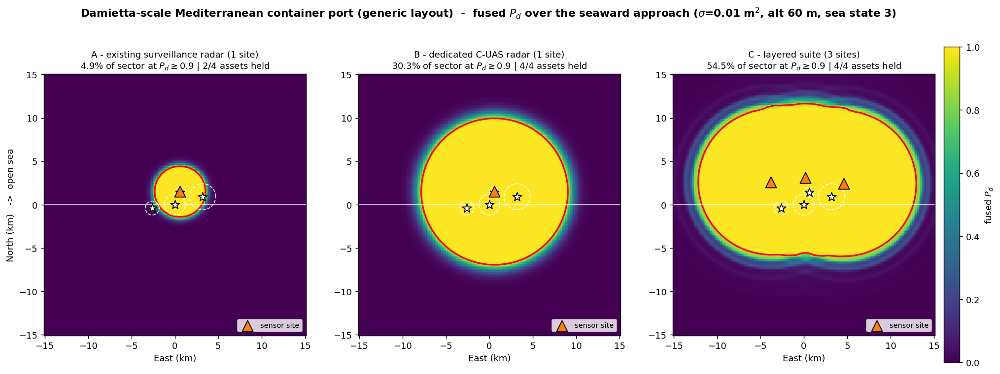
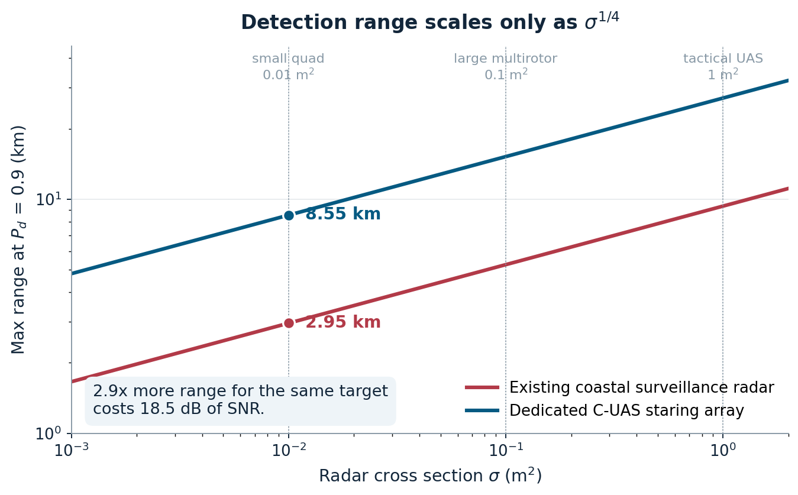
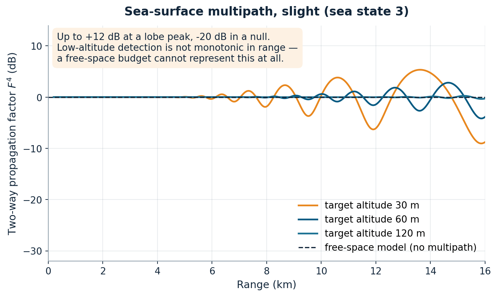
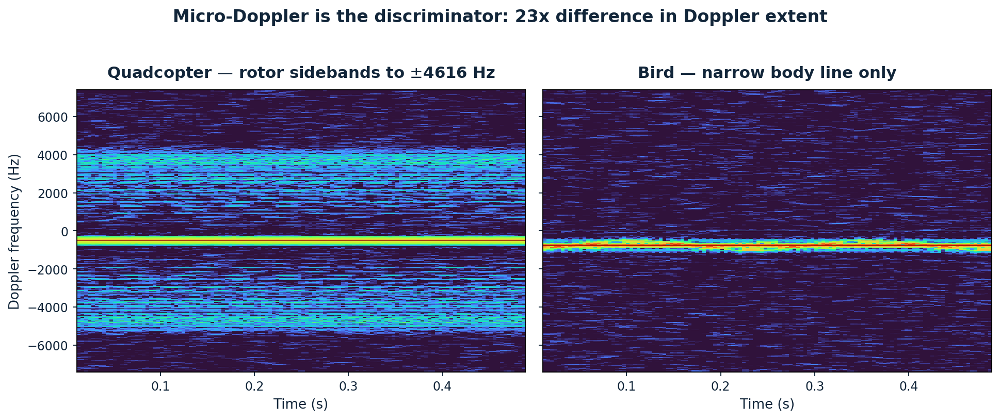
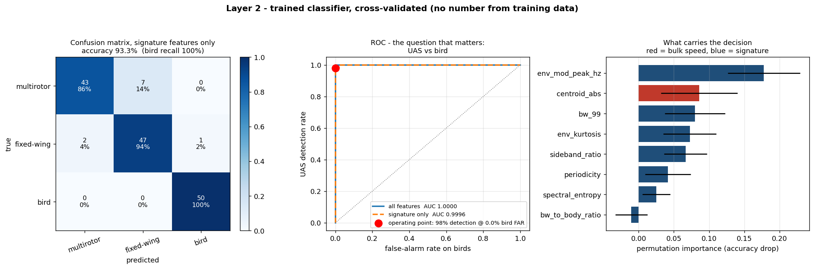
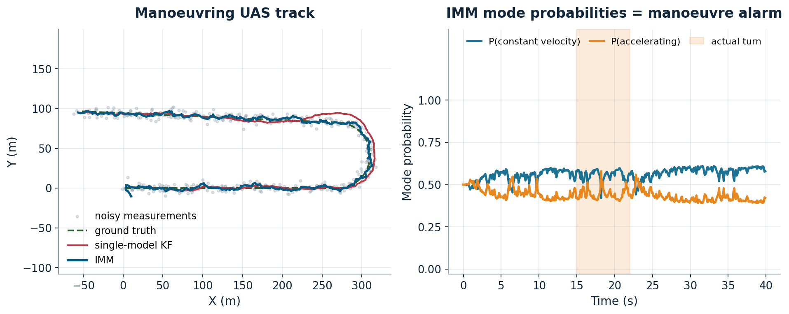
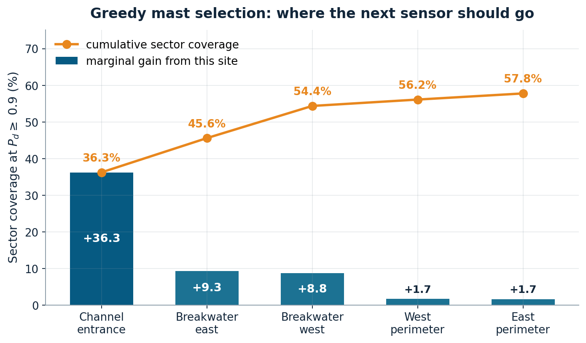
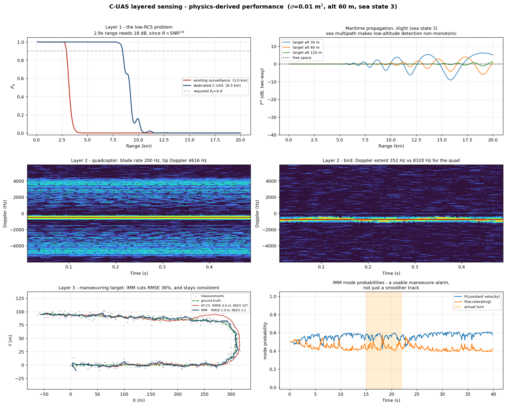

# Layered C-UAS Sensing Analysis

**A physics-derived simulation framework for evaluating counter-UAS sensor coverage over maritime port approaches.**

[](https://www.python.org/)
[](LICENSE)
[](docs/ROADMAP.md)

It turns detection theory into a siting decision: given a protected asset, a
threat profile and a set of candidate sensor positions, it computes where the
system meets its detection requirement, and where it does not.



> **Scope boundary.** This models *sensing* only: detection, classification and
> tracking performance. It contains no effector, jamming or intercept
> parameters, by design.

---

## The problem, in three numbers

A small quadcopter has a radar cross section around **0.01 m²**: roughly a
hundred times smaller than a light aircraft. Against that target:

| | Result |
|---|---|
| A port's **existing** coastal surveillance radar | detects at **2.95 km**, covering **4.9 %** of the seaward approach sector and holding **2 of 4** critical assets |
| A **dedicated** C-UAS staring array, same mast | **8.55 km**, **30.3 %** of the sector, **4 / 4** assets |
| **Three** optimally sited layered nodes | **54.5 %** of the sector, **4 / 4** assets |

The 2.89× range gain costs **18.5 dB** of SNR, because detection range grows
only as SNR^(1/4). That exponent is the whole engineering argument: adding
power is a losing strategy, and aperture plus dwell time is the winning one.

---

## Quick start

```bash
git clone https://github.com/AbdLAzeem/Anti-Drone-Radar.git
```

```bash
pip install -r requirements.txt
```

```bash
python run_demo.py
```

One command reproduces every number and figure below in about two minutes.
Results land in `reports/` as PNGs plus a machine-readable `results.json`.

Useful flags:

```bash
python run_demo.py --quick --rain 16 --sea-state 4 --rcs 0.01 --alt 60 --pd 0.9
```

| Flag | Meaning |
|---|---|
| `--quick` | coarse grid and small dataset (~30 s) |
| `--rcs` | target radar cross section, m² |
| `--alt` | target altitude, m |
| `--rain` | rain rate, mm/h |
| `--sea-state` | Douglas sea state, 0–5 |
| `--pd` | required probability of detection |

---

## Architecture

Four layers, each a physical model rather than a fitted curve.

| Module | Layer | What it computes |
|---|---|---|
| [`cuas/radar.py`](cuas/radar.py) | 1: Detection | Noise-limited SNR, exact Pd (Marcum Q / Swerling), Albersheim design inversion, range budgets, radar presets |
| [`cuas/propagation.py`](cuas/propagation.py) | n/a | Sea-surface two-ray multipath, ITU-R gaseous + rain attenuation, 4/3-Earth radar horizon |
| [`cuas/microdoppler.py`](cuas/microdoppler.py) | 2: Classification | Scatterer-based rotor and flapping-bird signature synthesis, spectrogram features |
| [`cuas/classify.py`](cuas/classify.py) | 2b: Classification | Randomised dataset, SVM, cross-validated confusion matrix / ROC / AUC, speed-feature ablation |
| [`cuas/tracking.py`](cuas/tracking.py) | 3: Fusion | Kalman (CV) and IMM (CV + CA) filters, RMSE and NEES validation, Monte-Carlo |
| [`cuas/system.py`](cuas/system.py) | 4: System | Physically-derived per-sensor Pd, layered fusion, 2-D coverage maps, greedy siting |
| [`cuas/scenarios.py`](cuas/scenarios.py) | n/a | Port deployment geometry, candidate masts, baseline-vs-dedicated-vs-layered comparison |

```
.
├── cuas/                  analysis package (7 modules)
├── run_demo.py            single entry point, reproduces everything
├── make_slide_figures.py  slide-sized figures
├── make_deck.js           pitch deck generator (pptxgenjs)
├── qa_deck.py             deck geometry checks + PowerPoint render export
└── docs/
    ├── ENGINEERING_NOTES.md   what changed from the prototype, and why
    ├── ROADMAP.md             next phase, with definitions of done
    ├── project_brief.md       compact context brief
    └── images/                figures used by this README
```

---

## How it works

### Layer 1: Detection

The receiver noise budget is derived rather than assumed:

```
SNR(R) = Pt·G²·λ²·σ·F⁴·n / ((4π)³·R⁴·k·Ts·B·NF·L·L_atm(R))
```

Detection probability comes from the exact distribution of the square-law
detector output: non-central chi-square for a non-fluctuating (Swerling 0)
target, scaled central chi-square for Swerling 2, not from an assumed
threshold.



### Maritime propagation

For a *port* study this is the effect that dominates the error budget. Direct
and sea-reflected rays interfere, producing a lobed vertical coverage pattern.
Since F enters SNR as F⁴, that is roughly **+12 dB at a lobe peak and −20 dB in
a null**: low-altitude detection is not monotonic in range, and a free-space
budget cannot represent this at all.



Surface roughness suppresses the coherent reflection (Ament factor), so sea
state changes the lobe structure. Gaseous and rain attenuation follow ITU-R
P.676 and P.838.

### Layer 2: Classification

Blades are modelled as distributed point scatterers, so the return carries the
real structure (body line, symmetric sidebands, periodic blade flashes):

```
R_m,b(t) = R₀ + v_body·t + r_m·sin(ωt + φ_b)·cos(θ_el)
s(t)     = Σ_b Σ_m w_m · flash(t) · exp(−j·4π·R_m,b(t)/λ)
```



| | Accuracy (5-fold CV) | UAS-vs-bird AUC | Bird false alarms @ ~98 % detection |
|---|---|---|---|
| All features | 94.0 % | 1.0000 | **0 %** |
| Speed feature removed | 93.3 % | 0.9996 | **0 %** |

Bird recall is **100 %** in both cases. Permutation importance showed bulk
radial Doppler carrying part of the decision, so it was removed and the model
re-scored, costing 0.7 accuracy points. The result therefore rests on the
micro-Doppler signature, not on how fast the target happens to fly. Remaining
confusion is multirotor ↔ fixed-wing, and both are UAS.



### Layer 3: Fusion

| Filter | Position RMSE | Mean NEES | Target NEES | Verdict |
|---|---|---|---|---|
| Single-model KF | 4.57 ± 0.26 m | **106.8** | 6.0 | over-confident |
| IMM (CV + CA) | **2.94 ± 0.15 m** | 3.21 | 6.0 | consistent |

The NEES column matters more than the RMSE. A correctly tuned filter has mean
NEES equal to the state dimension; 107 against a target of 6 means the
single-model filter is roughly **18× over-confident** during the manoeuvre: it
reports a covariance far smaller than its actual error, which is the standard
mechanism by which real trackers lose targets.



### Layer 4: System

Independent sensors fuse as `Pd_sys = 1 − Π(1 − Pdᵢ)`, evaluated over a 2-D
grid. Greedy maximum-coverage siting selects masts from a candidate list, each
carrying its own height, so the objective genuinely trades height (horizon,
lobe structure) against position.



Marginal gain falls monotonically (+36.3 → +9.3 → +8.8 → +1.7 → +1.7), which is
the submodularity that earns greedy selection its standard (1 − 1/e) ≈ 63 %
approximation guarantee. It also says where to stop buying: sites 4 and 5 add
1.7 points each.

---

### All four layers at a glance

`run_demo.py` also emits a single combined panel covering every layer under one
set of conditions, useful as a one-slide summary or a regression check after a
change:



---

## Validation

No claim in this repository rests on a single run.

- **Two independent paths agree.** The closed-form range equation and the exact
  Pd solve give 2.99 km and 2.95 km, 1.2 % agreement.
- **Synthesis checked against theory.** Measured 99 %-energy Doppler extent is
  8320 Hz against an analytic blade-tip Doppler of 4616 Hz, 90 % of the
  expected 2× two-sided spread.
- **Nothing reported from training data.** Classification uses
  `cross_val_predict`, so every prediction comes from a model that did not see
  that sample.
- **Filter consistency, not just error.** NEES is reported alongside RMSE.
- **Monte-Carlo, not anecdote.** Tracking results are 200 runs with standard
  deviations.

---

## Known limitations

Stated here rather than left for a reviewer to find. See
[`docs/ENGINEERING_NOTES.md`](docs/ENGINEERING_NOTES.md) for the full list.

- **Blade-passage rate is not measured as a physical quantity.** Two estimators
  were built and *rejected rather than shipped*: a harmonic product spectrum
  (lands on integer multiples: 3× for a 2-blade rotor, the classic HPS octave
  error) and autocorrelation of the Doppler spectrum for HERM-line spacing
  (correct for a 3-blade rotor, 230 Hz measured vs 225 Hz analytic, but off by
  ~2.7× for 2-blade rotors). The classifier uses an honestly-named modulation
  descriptor instead. Recovering the blade rate properly is roadmap item W1.
- **Synthetic data only.** The classifier has never seen a real radar
  recording. Randomised parameters and SNR guard against fitting one fixed
  signature, but accuracy on measured data will be lower.
- **Geometry is plausible, not surveyed.** A generic Mediterranean
  container-port layout at the right scale. Substituting surveyed positions is
  a data change, not a code change.
- **Independence assumed in fusion.** A correlated bound
  (`fused_pd_correlated`) and weather presets are provided, but common-mode
  failure is not fully modelled.
- **No clutter, false alarms or data association** in the tracking layer.
- **No ducting.** Evaporation ducts over warm sea can extend detection well
  past the 4/3-Earth horizon.
- **Swerling 1/3/4** are not implemented rather than approximated; Swerling 0
  and 2 bracket the realistic range for small UAS.

---

## Roadmap

[`docs/ROADMAP.md`](docs/ROADMAP.md) sets out the next phase with a definition
of done for each item: blade-rate recovery, a CNN benchmark on identical
folds, sea clutter and data association, a unit-test suite, multi-target and
degraded-weather scenarios, and a real-data validation path.

---

## Presentation deck

`make_deck.js` generates a 14-slide technical deck with speaker notes from the
same numbers the analysis produces, so the slides cannot drift from the code.

```bash
npm install pptxgenjs
```

```bash
python run_demo.py && python make_slide_figures.py && node make_deck.js
```

`qa_deck.py` then checks slide geometry and exports PNG renders through
PowerPoint for visual review.

---

## Requirements

Python 3.8+ with NumPy, SciPy, Matplotlib and scikit-learn. Developed against
NumPy 1.23, SciPy 1.10, Matplotlib 3.6 and scikit-learn 1.2 on Windows. Node.js
is needed only for the deck generator.

> **Note on SciPy.** `scipy.stats.ncx2` can abort the interpreter at very large
> non-centrality, which is exactly what a short-range, high-SNR cell produces.
> `radar.probability_of_detection` saturates those cells to 1.0 (exact to well
> beyond double precision) rather than calling into it.

---

## References

All open literature; no restricted sources.

- Skolnik, *Introduction to Radar Systems*, 3rd ed.
- Mahafza, *Radar Systems Analysis and Design Using MATLAB*
- Blake, *Radar Range-Performance Analysis*
- Albersheim, "A Closed-Form Approximation to Robertson's Detection
  Characteristics", *Proc. IEEE* 69(7), 1981
- Bar-Shalom, Li & Kirubarajan, *Estimation with Applications to Tracking and
  Navigation*
- ITU-R P.676 (gaseous attenuation), ITU-R P.838-3 (rain attenuation)

---

## Context

Developed as part of a graduation and doctoral research project on layered
counter-UAS concepts for maritime infrastructure protection, with Damietta as
the motivating case. All parameters are generic textbook values; the scope
boundary above is held throughout.

## License

Released under the [MIT License](LICENSE).
